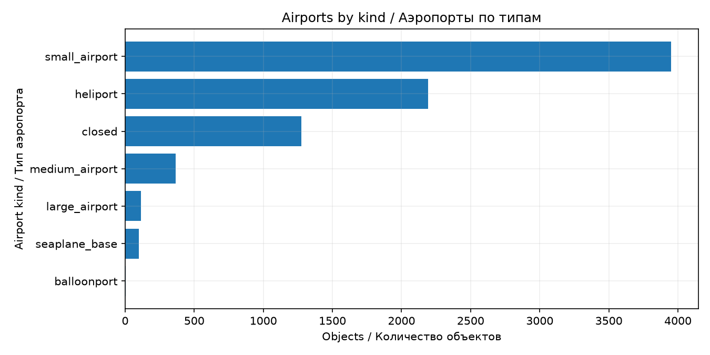
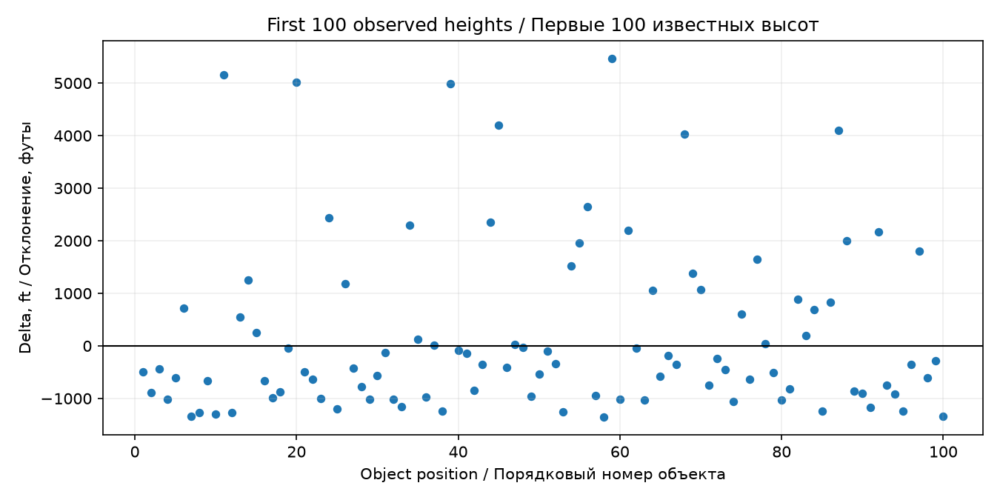
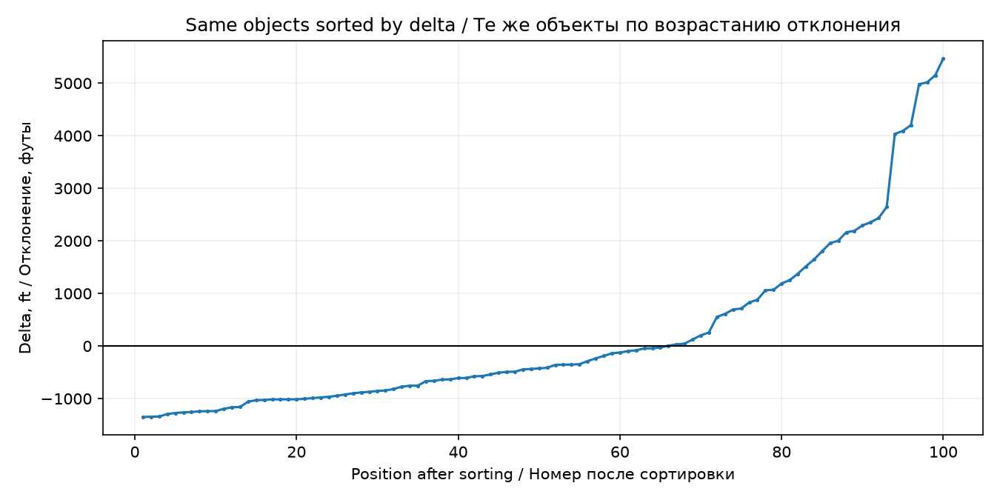
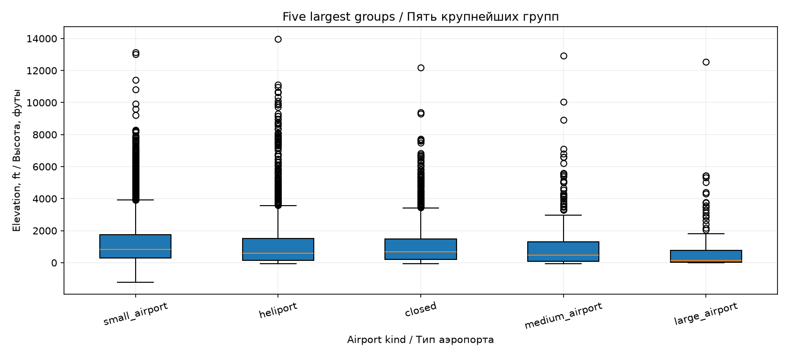

# Lab 2 report / Отчёт по ЛР2

## Data and method / Данные и метод

**EN:** The solution uses the airport catalog from Lab 1: 8,000 rows, with `elevation_ft` as X and `kind` as G. There are 6,550 known heights and 1,450 missing heights. The executed [notebook](analysis.ipynb) contains all ten assignment sections, bilingual explanations and four Matplotlib figures. NumPy selections use one generator initialized with seed 42. Missing groups are labeled `Неизвестно`; missing heights are excluded from statistics.

**RU:** Использован каталог аэропортов из ЛР1: 8 000 строк, X — `elevation_ft`, G — `kind`. Известны 6 550 высот, пропущены 1 450. Выполненный [блокнот](analysis.ipynb) содержит все десять разделов, пояснения на двух языках и четыре графика Matplotlib. Выборки NumPy используют один генератор с seed 42. Пустые группы получают имя `Неизвестно`, пропуски высоты исключаются из статистики.

## Missing values / Пропуски

**EN:** We hid 655 originally known heights. Filling statistics were calculated after removal; the saved true values were used only for evaluation. All methods filled the same damaged table independently. The third method used the observed median of the airport's type, with the global observed median as fallback.

**RU:** Были скрыты 655 исходно известных высот. Статистики заполнения рассчитаны после удаления; сохранённые ответы использовались только при проверке. Способы независимо заполняли одну и ту же повреждённую таблицу. Третий способ — медиана известных высот своего типа с резервной общей медианой.

| Method / Способ | MAE, ft / футы | MSE, ft² / футы² |
| --- | ---: | ---: |
| Global mean / Общее среднее | 1,136.78 | 2,595,470.66 |
| Global median / Общая медиана | 993.73 | 2,847,967.11 |
| Group median / Медиана группы | 981.19 | 2,866,265.57 |

**EN:** Group median is best by MAE, while global mean is best by MSE. MSE gives much more weight to large errors in the long upper tail of elevation. MAE and MSE have different units and should not be compared directly in magnitude. Group information improves typical absolute error here, but does not explain an individual airport's geography.

**RU:** Медиана группы лучше по MAE, общее среднее — по MSE. Квадраты усиливают большие ошибки в длинном правом хвосте высоты. MAE и MSE имеют разные единицы, поэтому их величины не сравниваются напрямую. Информация о типе здесь улучшает типичную абсолютную ошибку, но не объясняет географию конкретного аэропорта.

## Duplicates / Повторы

| Stage / Этап | Rows / Строки | Mean height, ft / Средняя высота, футы |
| --- | ---: | ---: |
| Baseline / Исходная таблица | 8,000 | 1,302.38 |
| Add 5% exact copies / Добавление 5% копий | 8,400 | 1,301.26 |
| Deduplicate all columns / По всем полям | 8,000 | 1,302.38 |
| Deduplicate id / По id | 8,000 | 1,302.38 |
| Deduplicate country / По стране | 193 | 1,225.96 |

**EN:** Original IDs are unique and there are no exact original duplicates, so exact-row and ID removal recover the baseline. Country is not an identity key: the notebook shows different airport IDs with the same country. Removing by country loses legitimate objects. The small mean shift after copying arises because the selected rows need not have the global mean.

**RU:** Исходные id уникальны, полных исходных повторов нет, поэтому первые два способа восстанавливают исходную таблицу. Страна не определяет идентичность: блокнот показывает разные id с одинаковой страной. Удаление по стране теряет настоящие объекты. Небольшое изменение среднего после копирования связано с отличием среднего случайно выбранных строк от общего.

## Statistics and filters / Статистика и фильтры

| Statistic / Характеристика | Result / Результат |
| --- | ---: |
| Range / Размах | 15,187.00 ft |
| Mean / Среднее | 1,302.38 ft |
| Median / Медиана | 730.00 ft |
| Population variance / Дисперсия с делением на N | 2,755,656.71 ft² |
| Standard deviation / Стандартное отклонение | 1,660.02 ft |
| Q1 / Квантиль 0.25 | 207.25 ft |
| Q2 / Квантиль 0.5 | 730.00 ft |
| Q3 / Квантиль 0.75 | 1,630.00 ft |

**EN:** Manual loops, sorting and arithmetic agree with NumPy and pandas within floating-point tolerance. Both comparisons use `ddof=0`. The mean substantially exceeds the median, consistent with the high positive tail visible in the boxplots.

**RU:** Ручные циклы, сортировка и арифметика совпадают с NumPy и pandas в пределах точности чисел с плавающей точкой. В сравнении используется `ddof=0`. Среднее заметно выше медианы, что согласуется с длинным правым хвостом на boxplot.

**EN:** For types `small_airport` and `medium_airport`, and height above 500 feet, AND selects 2,456 rows and OR selects 5,814; 3,358 occur only in OR. A missing height never passes the height condition. Filtering first and then taking five largest heights gives a different result from taking the global five and then filtering. The second order can discard eligible airports before the filter is applied.

**RU:** Для типов `small_airport` и `medium_airport` и высоты выше 500 футов И выбирает 2 456 строк, ИЛИ — 5 814; только в ИЛИ — 3 358. Пропуск высоты не проходит условие высоты. Фильтрация до выбора пяти максимумов даёт другой результат, чем общий top-5 до фильтрации. Во втором порядке подходящие аэропорты могут быть отброшены заранее.

## Groups and plots / Группы и графики

| Airport kind / Тип | Count / Количество | Share / Доля | Missing X / Пропуски X |
| --- | ---: | ---: | ---: |
| small_airport | 3,949 | 49.3625% | 480 |
| heliport | 2,194 | 27.4250% | 659 |
| closed | 1,274 | 15.9250% | 270 |
| medium_airport | 364 | 4.5500% | 18 |
| large_airport | 113 | 1.4125% | 0 |
| seaplane_base | 100 | 1.2500% | 23 |
| balloonport | 6 | 0.0750% | 0 |

**EN:** Small airports dominate and balloonports are rare. A many-to-one join adds group size and mean to each of the 8,000 original rows without changing count or order. Delta compares each known height to its type's mean. The two deviation plots use the same first 100 observed heights, first in source order and then sorted by delta with new sequential positions.

**RU:** Малые аэропорты преобладают, площадки аэростатов редки. Соединение many-to-one добавляет размер и среднее группы к каждой из 8 000 строк без изменения числа и порядка. Delta сравнивает высоту со средним своего типа. Оба графика отклонений используют те же первые 100 известных высот: сначала в исходном порядке, затем по delta с новыми последовательными номерами.

**EN:** Among the five largest groups, small airports have the highest median (830 ft), largest IQR (1,442 ft) and largest range (14,330 ft). Large airports have the lowest median (140 ft) and smallest IQR (716 ft), while still containing high-elevation outliers. Statistical outliers and negative elevations are not automatically data errors.

**RU:** Среди пяти крупнейших групп малые аэропорты имеют наибольшую медиану (830 футов), IQR (1 442 фута) и размах (14 330 футов). У крупных аэропортов наименьшая медиана (140 футов) и IQR (716 футов), хотя встречаются высокогорные выбросы. Статистические выбросы и отрицательные высоты не обязательно означают ошибки данных.

## Verification / Проверка

**EN:** The notebook was executed from a fresh Python kernel with nbclient. Assertions verify numeric X, identical preserved values after filling, duplicate addition counts, agreement of manual statistics, AND⊆OR, total group counts and shares, row-preserving enrichment, the same objects in both delta plots, sorted deltas and the unchanged original table. The JupyterLab launch and rerun instructions are included in the notebook. Detailed outputs are saved in `results/summary.json`, `imputation_metrics.csv` and `group_statistics.csv`.

**RU:** Блокнот выполнен из нового ядра Python через nbclient. Проверены числовой X, неизменность известных значений при заполнении, число добавленных повторов, совпадение статистик, И⊆ИЛИ, суммы размеров и долей групп, сохранение строк при соединении, одинаковые объекты на двух графиках delta, сортировка и неизменность исходной таблицы. Инструкции запуска и повторного выполнения в JupyterLab включены в блокнот. Подробные результаты сохранены в `results/summary.json`, `imputation_metrics.csv` и `group_statistics.csv`.
