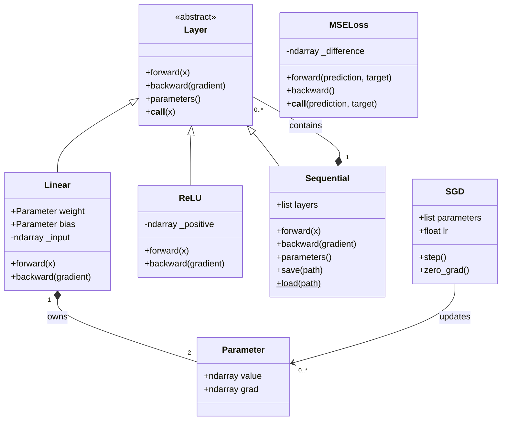
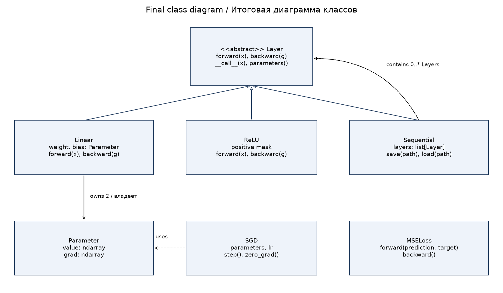
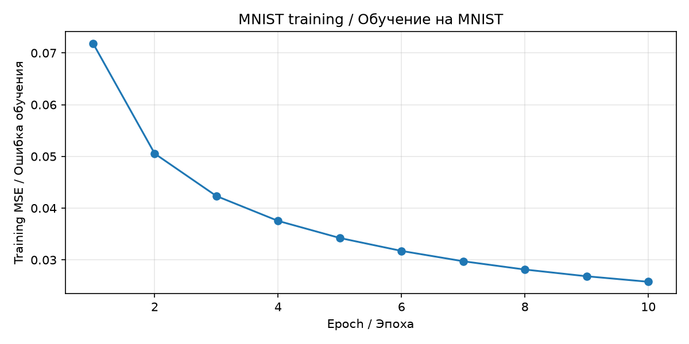
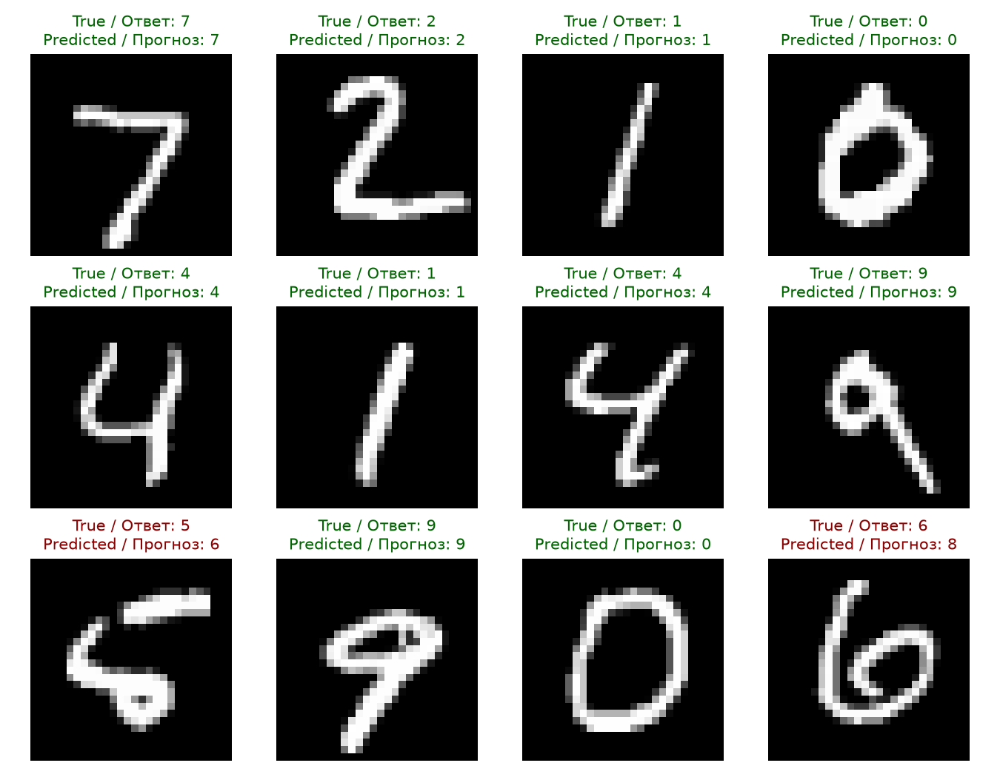
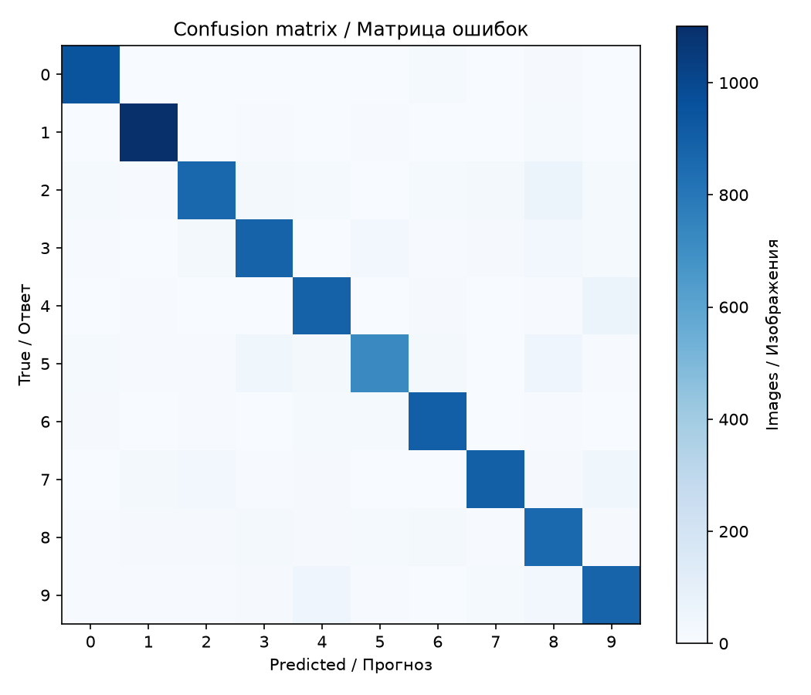

# Lab 3 report / Отчёт по ЛР3

## Implementation / Реализация

**EN:** [tutorial.ipynb](tutorial.ipynb) contains the complete implementation in structured code cells, English/Russian explanations, worked examples and executed MNIST results. Its implementation cells write separate modules under `minitorch/`, as required by the assignment. The library uses NumPy for computation and manual derivatives. scikit-learn is used only to obtain MNIST. A separate [script](mnist_demo.py) provides the training experiment without a notebook.

**RU:** [tutorial.ipynb](tutorial.ipynb) содержит полную реализацию в структурированных ячейках, пояснения на двух языках, примеры и результаты MNIST. Ячейки реализации записывают отдельные модули `minitorch/`, как требует задание. Библиотека использует NumPy и ручные производные. scikit-learn нужен только для получения MNIST. Отдельный [скрипт](mnist_demo.py) выполняет эксперимент без блокнота.

**EN:** The classes are `Parameter`, abstract `Layer`, `Linear`, `ReLU`, nested `Sequential`, `MSELoss` and `SGD`. The `train` function coordinates batches and returns sample-weighted epoch losses. Input and gradient shapes, invalid call order and invalid training settings are checked. Parameter gradients accumulate until `zero_grad()` is called.

**RU:** Реализованы `Parameter`, абстрактный `Layer`, `Linear`, `ReLU`, вложенный `Sequential`, `MSELoss` и `SGD`. Функция `train` организует порции и возвращает ошибку эпох с учётом числа объектов. Проверяются формы входов и градиентов, порядок вызовов и настройки обучения. Градиенты накапливаются до вызова `zero_grad()`.

## UML class diagram / UML-диаграмма классов

**EN:** Inheritance provides the shared layer interface; composition builds models from layer objects. Returning the same Parameter objects allows SGD to update the values used by forward. The initial design in notebook section 1 and the final diagram have the same class responsibilities; model persistence is implemented by Sequential.

**RU:** Наследование задаёт общий интерфейс слоя, композиция собирает модель из объектов. Возврат самих Parameter позволяет SGD обновлять значения, используемые forward. Первоначальная схема в разделе 1 блокнота и итоговая диаграмма сохраняют одинаковую ответственность классов; сохранение модели реализует Sequential.

## Experiment / Эксперимент

| Setting / Настройка | Value / Значение |
| --- | --- |
| Dataset / Датасет | OpenML `mnist_784`, version 1 |
| Train/test / Обучение/тест | First 60,000 / final 10,000 images |
| Input / Вход | 784 float32 pixels, divided by 255 |
| Targets / Ответы | 10-dimensional one-hot vectors |
| Architecture / Архитектура | Linear(784, 32) → ReLU → Linear(32, 10) |
| Trainable values / Обучаемые числа | 25,450 |
| Loss / Ошибка | MSE, averaged over objects and outputs |
| Optimizer / Оптимизатор | SGD, lr = 0.05 |
| Epochs / Эпохи | 10 |
| Batch size / Размер порции | 128; final batch 96 |
| Initialization and shuffle seed / Seed инициализации и перемешивания | 42 |

**EN:** The explicit `liac-arff` parser avoids a compatibility issue between the installed pandas version and scikit-learn's default category parser; the MNIST data and split are unchanged. Test images are used only for evaluation, with no parameter updates or test-based hyperparameter selection. Evaluation uses batches of 512 to limit memory.

**RU:** Явный парсер `liac-arff` обходит несовместимость установленного pandas со стандартным разбором категорий scikit-learn; данные MNIST и разделение не меняются. Тестовые изображения используются только для оценки без обновления параметров и подбора гиперпараметров по тесту. Оценка идёт порциями по 512 для экономии памяти.

## Measured results / Измеренные результаты

| Metric / Метрика | Result / Результат |
| --- | ---: |
| Test accuracy before training / Точность до обучения | 5.71% |
| Test accuracy after training / Точность после обучения | 89.51% |
| Correct test predictions / Правильные тестовые прогнозы | 8,951 / 10,000 |
| First epoch training MSE / MSE первой эпохи | 0.071865 |
| Final epoch training MSE / MSE последней эпохи | 0.025767 |
| Final test MSE / Итоговая тестовая MSE | 0.024392 |
| Maximum restored-score difference / Максимальное отличие после загрузки | 0.0 |

**EN:** Training reduces the measured epoch loss and improves recognition substantially. The baseline need not equal 10% because the random initial model is not a uniform random label generator. Epoch losses average batch losses measured while weights change; test loss is evaluated after training, so it need not be greater than the final training-history value. Outputs are scores, not probabilities.

**RU:** Обучение уменьшает измеренную ошибку эпох и заметно улучшает распознавание. Исходная точность не обязана быть 10%: случайная модель не равнозначна равномерному генератору цифр. Ошибки эпох усредняют порции при меняющихся весах, тестовая ошибка измерена после обучения, поэтому не обязана превышать последнее значение истории обучения. Выходы — оценки, а не вероятности.

**EN:** The image grid uses the first twelve test images rather than selecting successful cases. It includes errors, such as a 5 predicted as 6 and a 6 predicted as 8. The confusion matrix gives the complete test picture: true labels are rows and predictions are columns.

**RU:** Сетка показывает первые двенадцать тестовых изображений без отбора успешных случаев. Есть ошибки: например, 5 распознана как 6, а 6 — как 8. Матрица ошибок отражает весь тест: строки — настоящие цифры, столбцы — предсказанные.

## Persistence and checks / Сохранение и проверки

**EN:** `results/model.npz` contains a JSON description of the architecture and numeric parameter arrays. Loading uses `allow_pickle=False`, restores nested containers and resets gradients. The notebook checks exact equality of all 10,000 test output vectors after restoration. The separate six-test suite passes, including central finite-difference checks of weights, biases and input gradients, gradient accumulation and zeroing, invalid inputs, nested parameter identity, nested save/load and learning with incomplete batches.

**RU:** `results/model.npz` содержит JSON-описание структуры и числовые массивы. Загрузка использует `allow_pickle=False`, восстанавливает вложенность и обнуляет градиенты. Блокнот проверяет точное совпадение всех 10 000 тестовых выходных векторов после загрузки. Отдельные шесть тестов проходят: центральные разности весов, смещений и входов, накопление и обнуление, неверные входы, идентичность вложенных параметров, сохранение вложенности и обучение с неполными порциями.

**EN:** The notebook was executed from a fresh Python kernel using nbclient. Raw results and settings are in `results/metrics.json`; the full explanation is in [CODE_EXPLANATION.md](CODE_EXPLANATION.md), and bilingual oral preparation is in [DEFENSE_PREPARATION.md](DEFENSE_PREPARATION.md). Each layer caches one forward pass, so separate instances must be used at different model positions. This library does not support shared-layer computation graphs, GPU execution or general automatic differentiation.

**RU:** Блокнот выполнен из нового ядра Python через nbclient. Числа и настройки сохранены в `results/metrics.json`; подробный разбор — [CODE_EXPLANATION.md](CODE_EXPLANATION.md), подготовка к защите на двух языках — [DEFENSE_PREPARATION.md](DEFENSE_PREPARATION.md). Слой хранит один прямой проход, поэтому на разных позициях нужны разные экземпляры. Графы с разделяемыми слоями, GPU и общее автоматическое дифференцирование не поддерживаются.
